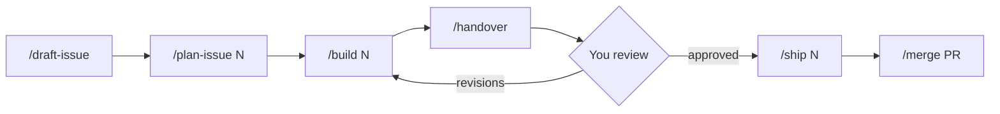

# User guide

How to work with these skills: which to use, in what order, and what each does. Each skill gets one line here. Its `SKILL.md` has the exact steps, and its page in `docs/skills/`, as each is written, has the finer points.

Commands you type are approvals: only you start `/new-project`, `/draft-issue`, `/build`, `/ship`, `/merge`, `/whats-next` and `/retro`. The rest Claude may also start when they fit.

## Set up

Once per machine, run `./install.sh` (see the [README](../README.md#install)). Then, once per project:

- [`/new-project <idea>`](../skills/workflow/new-project/SKILL.md): for a brand-new project. Turns an idea into a spec, CLAUDE.md, README, GitHub repo and first commit, one approved phase at a time.
- [`/setup-project`](../skills/workflow/setup-project/SKILL.md): for an existing project. Interviews you and writes `.claude/workflow.md`, the project facts (checks, merge style, whether merging deploys) the later skills read. Run it again when a skill says the project is behind.

## Each issue

Every change starts from an issue, so it has a recorded reason. Claude waits for you between steps, except that `/build` runs `/handover` itself.

1. [`/draft-issue <idea>`](../skills/workflow/draft-issue/SKILL.md): turns ideas into draft issues from the project's templates, splitting bigger work into a parent with children. Creates nothing until you approve.
2. [`/plan-issue <N>`](../skills/workflow/plan-issue/SKILL.md): shows a plan in chat, settles what's open with you, and posts it on the issue as `## Plan (approved)`.
3. [`/build <N>`](../skills/workflow/build/SKILL.md): makes the issue's branch and builds the plan, committing as it goes. Never pushes. Several issues build in parallel.
4. [`/handover`](../skills/workflow/handover/SKILL.md): runs the checks and a review, then posts a `## Handover` comment: what changed, test results, the review's findings and manual test steps. `/build` runs it for you.
5. **You review** the branch from the handover. For changes, ask for them: they become new commits and a new handover.
6. [`/ship <N>`](../skills/workflow/ship/SKILL.md): pushes the branch and opens its PR. A parent's `Ships as:` line decides whether its children ship as one PR or one each.
7. [`/merge <PR#>`](../skills/workflow/merge/SKILL.md): merges the PR, cleans up the branch, closes a finished parent, and lists what to check after a deploy.

## Along the way

Claude starts these itself when the work calls for them, mostly from inside the skills above. You can also ask for them by name.

- [`grilling`](../skills/guides/grilling/SKILL.md): rounds of numbered questions, each with a recommended answer, until every decision is yours and settled. Used by `/new-project`, `/setup-project`, `/draft-issue` and `/plan-issue`.
- [`tdd`](../skills/guides/tdd/SKILL.md): builds test-first in thin red-green slices, testing behaviour from the plan. Used by `/build`, and for bug fixes.
- [`fresh-eyes`](../skills/guides/fresh-eyes/SKILL.md): a review by readers with fresh context, which only reports. Used by `/handover` on a branch, and by `/new-project` on the spec.
- [`writing-skills`](../skills/authoring/writing-skills/SKILL.md): the style guide for skills and CLAUDE.md files. Used whenever one is written or changed.

## Housekeeping

- [`/whats-next`](../skills/workflow/whats-next/SKILL.md): recommends the next issue to work on, finishing started work first, with the command to run. Changes nothing.
- [`/retro`](../skills/authoring/retro/SKILL.md): looks back over the session for corrections and steps that went wrong, and ends with a `/draft-issue` line for each fix worth making. Changes nothing.
- **Switch this repo back to `main`** (`git switch main`) when you're done with a branch here. Installed skills are links into this folder, so whatever branch is checked out is the version every project runs.
